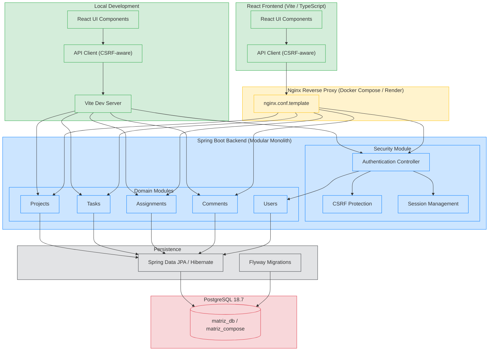

# Matriz — Architecture

## Architecture decision

Matriz uses a modular monolith: one Spring Boot backend deployment organized into domain packages, with a separate React frontend. The backend contains persistence packages for users, projects, tasks, assignments and comments. The frontend communicates with the backend through its REST APIs. Microservices are not part of the current architecture decision.

One backend deployment keeps deployment and operational complexity low. Internal modules separate responsibilities and support maintainability. Microservices would add communication and deployment complexity that is unnecessary for the current project scope.

## System architecture diagram

The diagram shows two request paths. In local development, the React frontend communicates with the Spring Boot backend via Vite's development proxy (`vite.config.ts`), bypassing Nginx. In Docker Compose and the prepared Render setup, Nginx serves the compiled React application and proxies all `/api/` requests to the backend. The backend's modular monolith contains a security module handling session-based authentication with CSRF protection, and domain modules for each business area. Spring Data JPA/Hibernate handles runtime data access to PostgreSQL, while Flyway manages schema migrations at application startup.

The client brief confirms only the need to organise projects, manage tasks and follow work progress. Detailed workflows and access rules remain project implementation decisions documented in requirements and user stories; they are not additional client-confirmed requirements.

## Implemented technology foundation

| Area | Selected technology | Version / detail |
|---|---|---|
| Backend language | Java | 21 |
| Backend framework | Spring Boot | 4.1.2 |
| Backend security | Spring Security | 7.1.2, managed by Spring Boot |
| Build | Maven | Maven project; requires a local Maven installation |
| Persistence mapping | Spring Data JPA / Hibernate | Hibernate validates the mapped schema at startup |
| Database | PostgreSQL | 18.7 verified locally |
| Database migrations | Flyway with Spring Boot integration | 13.12.1 |
| Frontend | React and TypeScript | React 19.3.1; TypeScript 7.0.2 |
| Frontend tooling | Vite and npm | Vite declared as `^8.3.6` (lockfile resolves 8.3.8); Node.js 24 and npm 11 |

These are project technology decisions, not client-imposed requirements. The Spring Security filter chain, username/password authentication, CSRF token endpoint, login, current-user and logout endpoints are implemented. Protected requests require authentication by default, and the session cookie policy is configured.

## Backend and persistence configuration

The backend is under `backend/`; the frontend is under `frontend/`. PostgreSQL connection settings are supplied as `DB_URL`, `DB_USERNAME` and `DB_PASSWORD`. Defaults provide a local URL and role name; the password must be provided through the process environment or IDE run configuration. Spring Boot does not automatically load `.env` files. `.env.example` is a fictional reference only, and `.gitignore` excludes real `.env` files.

Flyway reads versioned SQL from `classpath:db/migration`. V1 creates the five core tables, V2 inserts reproducible demonstration records, and V3 disables seeded demo credentials until local provisioning. Flyway records successful migrations in `flyway_schema_history` and does not rerun them on ordinary restarts. Hibernate is configured with `ddl-auto=validate`, so it checks the mapped schema without creating or resetting it.

## Current boundaries and pending decisions

The backend includes JPA mappings, repository interfaces, database configuration, migrations, authentication, project and task APIs, assignments, and comments. Project endpoints support authenticated listing, name search, viewing and creation, with owner-only updates and deletion; deletion is rejected while tasks remain. Task deletion is limited to the project owner or task creator. The React frontend implements authentication, dashboard, project and task views, assignment and comment workflows. Dashboard summaries are assembled from the project, task, and assignment APIs; no separate dashboard endpoint is implemented. Backend controller tests use MockMvc and mostly mocked repositories; the dedicated PostgreSQL persistence tests provide separate real-database evidence. Local startup and build checks are documented in the root README.

The implemented backend includes project-name search, task filters and pagination, task status and priority, assignments, and comments. The frontend computes dashboard counts from the existing APIs. The session policy is IF_REQUIRED with session-ID rotation and CSRF-token invalidation through the shared session authentication strategy. `GET /api/auth/csrf` returns the XOR handler-exposed token and its header name; clients send the token as `X-CSRF-TOKEN` for state-changing requests and obtain a fresh token after login and logout. The session cookie is named `JSESSIONID`, HttpOnly and SameSite=Lax; Secure defaults to true and is false only in the local profile. Account lifecycle, deployment and non-functional targets remain unresolved. Continue to distinguish client-confirmed needs from project decisions and open business rules.
