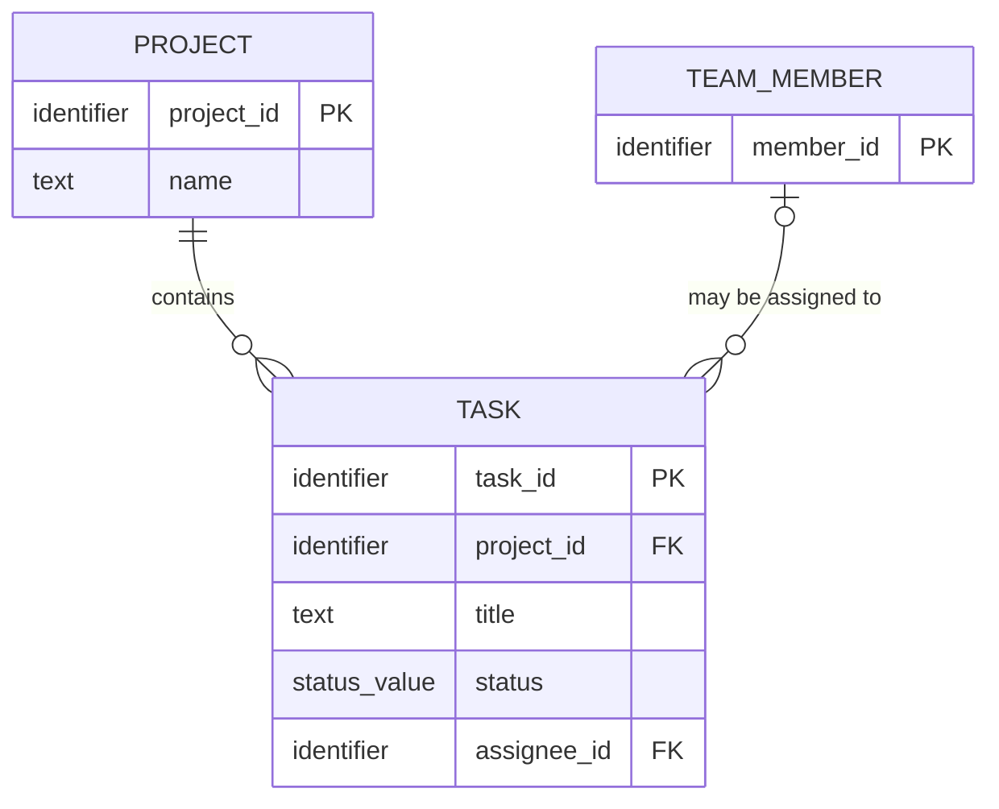

# Matriz — Proposed MVP Data Model

## 1. Summary and Scope

This document proposes a conceptual data model for the Matriz MVP described in the project requirements. It supports projects, tasks associated with projects, and task statuses used to follow work progress. It is technology-independent and does not select a database or define implementation code.

**Confirmed client need:** teams need to organise projects, manage tasks and follow work progress.

**Proposed MVP scope, pending client validation:** create and view projects; create, view and edit tasks; associate tasks with projects; update task status; and view task statuses within a project. These detailed features are not client-confirmed requirements.

**Proposed model:** store project and task records, with each task referring to one project and storing its current status. These task records and statuses provide the data from which project progress could be calculated. Whether progress is shown as task statuses, a count of completed tasks, a percentage, or another view—and the exact calculation—remains pending client validation. Progress does not need a separate stored entity in this model.

Task assignment is a candidate feature pending client validation. The diagram shows its minimal conditional relationship to make the data impact visible; it is not part of the core proposed MVP.

## 2. Entities and Attributes

Attribute types below are conceptual labels, not database-specific types. Requiredness and detailed validation remain subject to the open questions in this document.

### Project — proposed MVP entity

Represents a project that groups related tasks.

| Attribute | Key | Meaning and status |
|---|---|---|
| `project_id` | Primary key (PK) | Identifier for the project. |
| `name` | — | Project name. A name is assumed by user story US01; other project fields and final requiredness remain to be validated. |

### Task — proposed MVP entity

Represents a task associated with a project.

| Attribute | Key | Meaning and status |
|---|---|---|
| `task_id` | Primary key (PK) | Identifier for the task. |
| `project_id` | Foreign key (FK) | References `Project.project_id`; every task is associated with one valid project under the proposed requirement FR04. |
| `title` | — | Task title. US03 assumes a title and rejects an empty one; other task fields and final requiredness remain to be validated. |
| `status` | — | The task's current status, used for status updates and project status viewing. The allowed values and transition rules are undecided. |
| `assignee_id` | Conditional FK | If assignment is approved, references `TeamMember.member_id`. The field is optional in this proposal because mandatory assignment is unresolved. |

### TeamMember — conditional entity for task assignment

This entity is included only to show the data reference that would be needed if the candidate assignment feature is approved. It is not required by the core proposed MVP.

| Attribute | Key | Meaning and status |
|---|---|---|
| `member_id` | Primary key (PK) | Identifier referenced by an assigned task. The source and other identity attributes are undecided; this model does not define an account or authentication record. |

No separate status, progress, role, permission, account, or project-membership entity is proposed. The current requirements do not define a need or rules for those records. If assignment eligibility depends on project membership, that relationship must be defined after the client clarifies the rule.

## 3. Relationships and Cardinalities

| Relationship | Cardinality | Justification and status |
|---|---|---|
| Project to Task | One Project has zero or many Tasks; each Task belongs to exactly one Project. | Projects may have no tasks (US05/EC02); FR04 and the proposed model associate each task with a project. |
| TeamMember to Task | If assignment is approved: one TeamMember may be assigned zero or many Tasks; each Task may have zero or one assigned TeamMember. | Conditional cardinality based on the candidate US06 wording, which assigns a task to a team member. Assignment, eligibility and whether one or multiple assignees are allowed require client validation. |

## 4. Business Rules Represented

- A task refers to one project. A task must not refer to a missing project; this supports FR04 and exceptional case EC05.
- A project may have no tasks. In that case, its task list is empty and no progress value is fabricated.
- A task stores its current status so it can be updated and displayed within its project. The model does not prescribe status names, a workflow, or transition restrictions.
- Progress Tracking reads tasks and their statuses from Task Management. The stored task records and statuses provide the data needed for a progress calculation, if the client requires one. The calculation is derived rather than stored as a separate entity; whether it uses a completed-task count, percentage, or another rule remains undecided.
- If assignment is approved, a task may reference an assignee. The conditional relationship does not define who is eligible or how eligibility is determined.
- Shared validation and access protection are responsibilities in the architecture proposal, not additional data entities here. Access rules and permissions are not defined by this model.

## 5. Mermaid ER Diagram

The diagram shows the proposed core entities and the conditional assignment entity. `PK` and `FK` mark primary and foreign keys. The assignment relationship and `assignee_id` apply only if task assignment is validated for the MVP.

`TEAM_MEMBER` and the `TEAM_MEMBER`–`TASK` relationship are conditional. If assignment is not approved, omit `TEAM_MEMBER`, `TASK.assignee_id` and that relationship from the eventual implementation model.

## 6. Assumptions and Questions for Client Validation

### Provisional assumptions reflected in this proposal

- A project has a name; a task has a title and belongs to a project, as stated in the assumptions and acceptance criteria in the user stories.
- A task has a current status, supporting the proposed status update and status visibility requirements.
- If assignment is approved, a task has at most one assignee, based on the singular assignee in the candidate story. This is not confirmed.
- The task records and statuses are the source data for project progress. The final progress representation and any calculation are undecided; neither a percentage nor a completed-task count is assumed.

### Open questions

- What fields must projects and tasks contain, and which are required? The model includes only the assumed project name and task title beyond identifiers and required relationships/status.
- Which task status values are valid? Are there restrictions on transitions between statuses?
- Is task assignment part of the MVP? Is it optional or mandatory, can a task have multiple assignees, and what makes a team member eligible?
- What information identifies a team member, and where does that identity come from if assignment is approved? Authentication and account management remain undecided.
- How should project progress be presented and calculated from task data? Should users see statuses only, a count of completed tasks, a percentage, or another representation? No formula or status-to-progress rule is assumed.
- What access restrictions apply to project and task records? This model does not define permissions.

## 7. Consistency Review and Limitations

- The core proposed MVP's stored data is represented by `Project` and `Task`; project creation/viewing and task creation/viewing/editing/status updates map to their attributes and relationship.
- Project progress can be derived from the stored task records and statuses, read by Progress Tracking from Task Management; no separate progress entity is included. The client must still define whether and how to calculate or display a summary.
- Every relationship in the diagram matches the written cardinalities: each task has exactly one project; a project may have zero or many tasks; the conditional assignment permits zero or one assignee per task and zero or many tasks per team member.
- The optional assignment reference is explicitly conditional and does not establish user roles, eligibility or project membership.
- This conceptual model does not decide database technology, implementation types, detailed requiredness, access-control rules, status values, or progress calculations. Those decisions depend on client validation.
