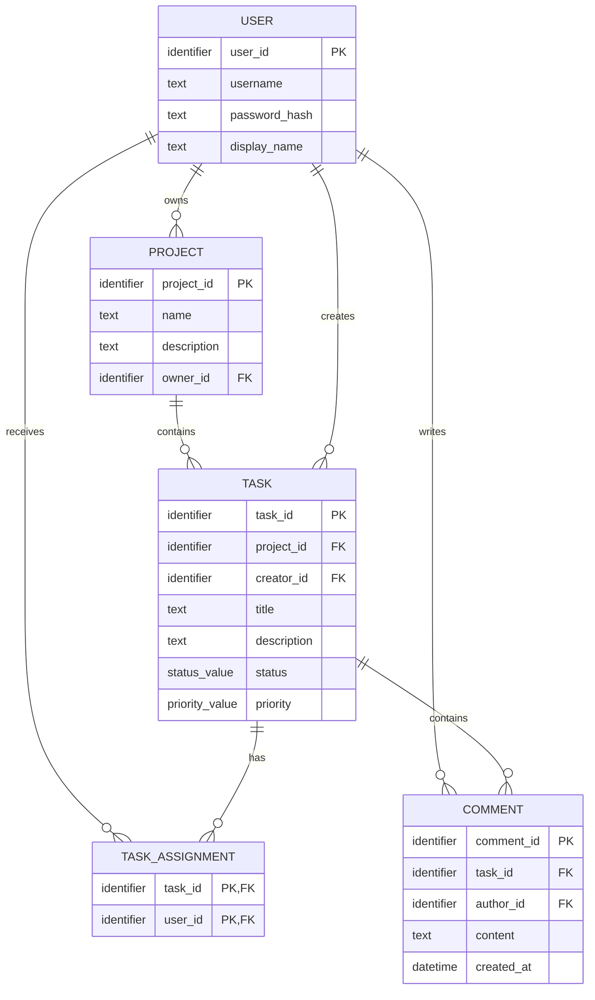

# Matriz — Data Model

## 1. Summary and Scope

This document defines the proposed conceptual data model for the Matriz project implementation. It describes the entities, attributes and relationships needed to support user authentication, project and task management, multiple task assignees, task comments and progress visibility.

The original client brief establishes the need to organise projects, manage tasks and follow work progress. The documented project scope extends the initial client brief with project implementation decisions; it is not additional client-confirmed scope. This expanded scope should not be interpreted as independent confirmation that the client validated every detailed behaviour.

The model must support:

- User accounts and identification of the authenticated user.
- All authenticated users can create, list and view all projects; each project's creator is its owner, and only the owner can edit or delete it.
- Tasks associated with projects, including creator, status and priority. Any authenticated user can create, view and update a task in any project; only the project owner or task creator can delete it.
- Multiple assignments to any existing user account, regardless of project ownership; any authenticated user may add or remove assignments, and duplicate task/user pairs are prevented.
- Task comments with author and creation date; any authenticated user can view and add them.
- Project-name search and task status/priority filtering with the approved matching rules.
- Dashboard counts derived from all tasks across all projects, grouped for all three statuses including zero counts.

The sections below retain the conceptual model and describe its implemented PostgreSQL realization. PostgreSQL schema details, migration files and configuration are recorded separately so conceptual rules remain distinct from implementation details.

These are project decisions for the project implementation, not client-confirmed requirements. Account lifecycle details remain unspecified. Project/task fields, validation, access and deletion behavior are recorded below.

## 2. Entities and Attributes

The entities below represent the proposed data model for the project implementation. Attribute types in this conceptual section are labels rather than database-specific types. The implemented schema is summarized in section 8.

### User — account entity

Represents a user account that can authenticate and interact with Matriz.

| Attribute | Key | Meaning and status |
|---|---|---|
| `user_id` | Primary key (PK) | Unique identifier for the user. |
| `username` | Unique candidate | Selected login identifier for account authentication. |
| `password_hash` | — | Password hash for local authentication. Plain-text passwords must not be stored. |
| `display_name` | — | Name displayed in the interface and alongside comments and assignments. |

The account model supports login, logout and retrieval of the current authenticated user. Public registration and password recovery are optional and are not required for the initial implementation. V2 seeds the reserved demo usernames `demo.alex` and `demo.sam`; the separate local provisioning command targets these same accounts. Broader account lifecycle decisions remain unresolved.

### Project — project entity

Represents a project that groups related tasks.

| Attribute | Key | Meaning and status |
|---|---|---|
| `project_id` | Primary key (PK) | Unique identifier for the project. |
| `name` | — | Required project name, 3–150 characters. |
| `description` | — | Optional project description, maximum 2,000 characters. |
| `owner_id` | Foreign key (FK) | References `User.user_id`; set by the backend to the authenticated user who created the project. |

All authenticated users may view the project. Only its owner may edit or delete it. A project with tasks cannot be deleted; the API returns HTTP `409 Conflict`.

### Task — task entity

Represents a task associated with one project.

| Attribute | Key | Meaning and status |
|---|---|---|
| `task_id` | Primary key (PK) | Unique identifier for the task. |
| `project_id` | Foreign key (FK) | References `Project.project_id`; each task belongs to one valid project. |
| `creator_id` | Foreign key (FK) | References `User.user_id`; records the authenticated user who created the task. |
| `title` | — | Task title. The documented rules specify a length between 3 and 150 characters. |
| `description` | — | Optional task description, with a maximum length of 2,000 characters under the documented validation rules. |
| `status` | — | Current task status. Supported values: `TODO`, `IN_PROGRESS`, `DONE`. Default: `TODO`. |
| `priority` | — | Task priority. Supported values: `LOW`, `MEDIUM`, `HIGH`. Default: `MEDIUM`. |

The status and priority values and defaults above follow the documented project decision. They must be used consistently in the API, database and interface.

### TaskAssignment — task-user association

Represents the assignment of a user to a task. This association allows a task to have multiple assignees; any existing account may be assigned regardless of project ownership.

| Attribute | Key | Meaning and status |
|---|---|---|
| `task_id` | Composite primary key (part) and FK | References `Task.task_id`. |
| `user_id` | Composite primary key (part) and FK | References `User.user_id`. |

The combination of `task_id` and `user_id` must be unique, preventing the same user from being assigned to the same task more than once. Any authenticated user may add or remove these assignment links.

### Comment — task comment entity

Represents a comment added to a task.

| Attribute | Key | Meaning and status |
|---|---|---|
| `comment_id` | Primary key (PK) | Unique identifier for the comment. |
| `task_id` | Foreign key (FK) | References the task being commented on. |
| `author_id` | Foreign key (FK) | References `User.user_id`; the backend derives the author from the authenticated identity. |
| `content` | — | Comment text. The documented rules require 1–2,000 characters and reject whitespace-only content. |
| `created_at` | — | Date and time the comment was created, recorded by the backend. |

Any authenticated user may add and list comments on any task. Comment editing is not included in the documented scope. Deleting a task also deletes its comments.

### Access Rules and Derived Information

The approved project access rules are: all authenticated users can create/list/view projects; only the owner can edit/delete a project. Any authenticated user can create/view/update tasks in any project; only the project owner or task creator can delete a task. Any authenticated user can view/add comments and add/remove task assignments. Any existing account is assignment-eligible, regardless of project ownership.

Project deletion is restricted while tasks exist (`409 Conflict`). Task deletion cascades to its assignments and comments. Dashboard counts across all projects are derived from tasks, include `TODO`, `IN_PROGRESS` and `DONE` even at zero, and ignore priority and assignees; no separate count/progress entity is needed. Search and filters operate on existing records.

## 3. Relationships and Cardinalities

| Relationship | Cardinality | Justification |
|---|---|---|
| User to Project (owner) | One User may own zero or many Projects; each Project has one owner. | The backend records the authenticated project creator as owner. |
| Project to Task | One Project has zero or many Tasks; each Task belongs to exactly one Project. | Projects may have no tasks; every task must reference a valid project. |
| User to Task (creator) | One User may create zero or many Tasks; each Task has exactly one creator. | Supports the approved task deletion rule. |
| User to Task (assignee) | One User may be assigned to zero or many Tasks; each Task may have zero or many assigned Users. | The documented rules require multiple eligible users to be assignable to a task. |
| Task to TaskAssignment | One Task has zero or many TaskAssignment records; each TaskAssignment refers to exactly one Task. | Implements the task side of the many-to-many assignment relationship. |
| User to TaskAssignment | One User has zero or many TaskAssignment records; each TaskAssignment refers to exactly one User. | Implements the user side of the many-to-many assignment relationship. |
| Task to Comment | One Task has zero or many Comments; each Comment belongs to exactly one Task. | The documented rules require comments to be added to and listed for a task. |
| User to Comment (author) | One User may author zero or many Comments; each Comment has exactly one author. | The backend records the authenticated user as the comment author. |

The `TaskAssignment` entity is an association between `Task` and `User`. The pair `(task_id, user_id)` must be unique so that a user cannot be assigned to the same task more than once.

Project ownership governs only project edit/delete and is one of the two bases for task deletion. All authenticated users can view all projects and access tasks/comments in any project. Assignment eligibility does not depend on ownership.

## 4. Business Rules Represented

- **Project ownership and permissions:** The creator is recorded as owner. All authenticated users may create/list/view projects; only the owner may edit/delete.
- **Project-task relationship:** Each task must belong to one valid project. A project may have zero or many tasks. The application must prevent orphaned tasks.
- **Task creator and permissions:** The backend records the authenticated task creator. Any authenticated user may create/view/update tasks in any project; only the project owner or task creator may delete.
- **Project deletion:** Deletion is restricted while tasks exist and returns HTTP `409 Conflict`.
- **Task deletion:** Deleting a task removes its task-assignment and comment records.
- **Project fields and validation:** Name is required and 3–150 characters; description is optional and at most 2,000 characters.
- **Task fields and validation:** Task title is required and must contain 3–150 characters. Description is optional and may contain up to 2,000 characters.
- **Task status:** A task stores its current status. Supported values are `TODO`, `IN_PROGRESS` and `DONE`; the default is `TODO`.
- **Task priority:** A task stores its priority. Supported values are `LOW`, `MEDIUM` and `HIGH`; the default is `MEDIUM`.
- **Multiple task assignees:** A task may have zero or many assignees. Each assignment links one task to one user, and duplicate task-user associations are not allowed.
- **Assignment permissions and eligibility:** Any authenticated user may add/remove task assignments. Any existing user account may be assigned regardless of project ownership. A task may have multiple assignees; duplicate task/user associations are prohibited.
- **Comments:** Each comment belongs to one task and has one author and a creation date. Any authenticated user may view/add comments; the backend derives author/date. Content must be 1–2,000 characters and not whitespace-only.
- **Authentication:** User accounts support login, logout and retrieval of the current authenticated user's identity. Passwords must not be stored in plain text.
- **Access control:** The backend enforces the approved project/task rules above. All authenticated users can search/list all projects, filter tasks across projects and view the global dashboard; project edit/delete and task delete use the specified owner/creator rules.
- **Dashboard counts:** Include all projects and tasks across them, grouped for all statuses (including zero) regardless of priority/assignee. Counts are derived and not stored separately.
- **Search and filters:** Search is partial/case-insensitive after trimming query-edge whitespace; empty/omitted query returns all projects. Task filters combine with AND; omitted filters do not restrict results.
- **Deletion and dependent records:** Project deletion is restricted if it contains tasks (`409 Conflict`). Task deletion cascades to its assignments and comments.

## 5. Mermaid ER Diagram

The diagram represents the proposed conceptual data model for the project implementation. `PK` identifies a primary key and `FK` identifies a foreign key.

`TASK_ASSIGNMENT` implements the many-to-many relationship between users and tasks. Its composite primary key prevents duplicate assignments of the same user to the same task.

The diagram represents the following rules:

- Each project has one owner.
- Each task belongs to exactly one project.
- Each task has exactly one creator.
- A task may have zero or many assignees.
- A user may be assigned to zero or many tasks.
- Each comment belongs to exactly one task and has exactly one author.
- A project or task may exist without comments or assignments.

Referential behavior: a project with tasks cannot be deleted; task deletion cascades to its assignment and comment rows. Application authorization follows the approved rules in §4.

## 6. Assumptions and Questions for Implementation

### 6.1 Documented Project Decisions

The following model elements reflect the minimum functional scope and validation rules specified by documented project scope:

- User accounts support authentication and identification of the current user.
- Any authenticated user can create/list/view all projects; the creator is owner and only the owner can edit/delete.
- Project name is required (3–150 characters); description is optional (maximum 2,000 characters).
- Tasks belong to projects and support creation, viewing, editing and deletion.
- Any authenticated user can create/view/update tasks in any project; the backend records the creator; only the project owner or task creator may delete.
- Task titles contain between 3 and 150 characters.
- Task descriptions have a maximum length of 2,000 characters.
- Supported task statuses are `TODO`, `IN_PROGRESS` and `DONE`, with `TODO` as the default.
- Supported task priorities are `LOW`, `MEDIUM` and `HIGH`, with `MEDIUM` as the default.
- Any authenticated user may add/remove assignments; any existing account is eligible regardless of project ownership, and tasks may have multiple assignees.
- Duplicate task-user assignments are not allowed.
- Project deletion is restricted while tasks exist; task deletion cascades to assignments and comments.
- Comments are associated with tasks and record their author and creation date.
- Comment content contains between 1 and 2,000 characters and must not consist only of whitespace.
- Dashboard counts across all projects include `TODO`, `IN_PROGRESS` and `DONE`, including zero; counts ignore priority and assignees and are derived from tasks.
- Project search is trimmed, case-insensitive partial matching; empty/omitted query returns all projects. Task filters combine with AND; omitted filters do not restrict results.

### 6.2 Recorded Project Decisions

These project decisions are approved for the project implementation, not independently confirmed by the original client:

- Each project has one owner, identified by `owner_id`; the backend derives ownership and comment authorship from the authenticated user, not client-supplied identity values.
- Each task records `creator_id`, used with project ownership to authorize deletion.
- `TaskAssignment` uses a composite key consisting of `task_id` and `user_id`.
- Any existing user account is eligible for assignment; assignment eligibility does not require project ownership.
- The project/task/comment/assignment permissions, project restriction and task cascade deletion rules in §4 apply.
- Dashboard counts, project search and task filters follow the rules in §4 and use existing records rather than separate persisted data.
- Comments can be added and listed; editing is outside documented scope.

These decisions implement the project scope; they are not additional requirements confirmed by the original client.

### 6.3 Remaining Questions

The following matters remain unresolved or outside the current implemented account lifecycle:

- Which additional user attributes or lifecycle operations, beyond the selected `username` login identifier and `display_name`, are required?
- Should public registration and password recovery be added?
- Should project and task creation dates or update dates be stored?
- Should comment editing be added in a future extension? It is outside the current scope.

Decisions must be recorded consistently in the requirements, architecture, API contract and implementation documentation.

## 7. Consistency Review and Limitations

- The model includes the entities needed to support the documented project scope: `User`, `Project`, `Task`, `TaskAssignment` and `Comment`.
- Each task belongs to exactly one project, while a project may contain zero or many tasks.
- Multiple task assignees are represented through the `TaskAssignment` association rather than a single assignee field.
- The composite key on `TaskAssignment` prevents duplicate assignments of the same user to the same task.
- Comments are associated with a task and a user author. Their creation date is recorded as part of the comment.
- Task status and priority values and defaults follow the documented project decisions.
- Dashboard counts, project search and task filters use existing project and task records. They do not require separate data entities.
- Project ownership and task creator support the approved project-edit/delete and task-delete rules; all authenticated users otherwise have the documented project/task/comment access.
- The model records the approved restrictive project deletion and task dependent-record cascades.
- The conceptual model is realized by PostgreSQL migrations; see section 8. Deployment configuration remains outside this data model.
- The model must remain consistent with `docs/requirements.md`, `docs/user-stories.md`, `docs/architecture.md`, `docs/constraints.md` and `openapi.yaml`.
- Any unresolved business rules must be documented before implementing the affected operations.

This conceptual model should be read alongside the API contract, implementation plan and implemented schema in section 8.

## 8. Implemented PostgreSQL Schema and Migrations

The conceptual entities are implemented in PostgreSQL by versioned Flyway migrations under `backend/src/main/resources/db/migration`. V1 creates `users`, `projects`, `tasks`, `task_assignments` and `comments`; V2 inserts deterministic demonstration records. Flyway is enabled in `backend/src/main/resources/application.properties`, uses `classpath:db/migration`, and applies pending migrations at application startup. Successful versions are recorded in `flyway_schema_history`; normal restarts do not reapply them. Hibernate uses schema validation and does not create or reset tables.

| Table | Implemented representation and constraints |
|---|---|
| `users` | UUID primary key; unique non-null `username` (100); non-null `password_hash` (255); non-null `display_name` (150). V3 replaces null password values and the demo accounts' credentials with the non-authenticating `!DISABLED!` marker before enforcing `NOT NULL`. |
| `projects` | UUID primary key; non-null name (3–150 characters); nullable description (up to 2,000); required owner FK with deletion restricted. |
| `tasks` | UUID primary key; required project and creator FKs, both deletion restricted; title (3–150); optional description (up to 2,000); status constrained to `TODO`, `IN_PROGRESS`, `DONE` with `TODO` default; priority constrained to `LOW`, `MEDIUM`, `HIGH` with `MEDIUM` default. |
| `task_assignments` | Task and user FKs; composite primary key `(task_id, user_id)` prevents duplicates; task deletion cascades and user deletion is restricted. |
| `comments` | UUID primary key; task and author FKs; content length 1–2,000 and non-whitespace constraint; required `TIMESTAMPTZ`; task deletion cascades and author deletion is restricted. |

Indexes are created for `tasks.project_id`, `task_assignments.user_id` and `comments.task_id`. The migration schema encodes structural constraints; it does not implement application authorization, authentication or API workflows. The application implements session authentication and project/task/comment/assignment workflows, including project-owner and task creator-or-owner checks and conflict responses for dependent project deletion or duplicate assignments.

`username` is the implemented login identifier. Account registration and password recovery are not implemented; account lifecycle beyond the local demo-account provisioning workflow remains unresolved. At the API boundary, project names, task titles, task descriptions and comment content are validated with Jakarta Bean Validation and tested through MockMvc; invalid input is returned as HTTP `400 Bad Request` with an error message.

V2 seeds two users (`demo.alex`, `demo.sam`), two projects owned by different users, two tasks, two cross-owner assignments and one comment. These exact usernames are reserved for the demo accounts; the local provisioner targets the same pair. Seed inserts use fixed identifiers and conflict-safe inserts. V3 disables both demo accounts in every environment where the migration runs; it contains no usable password hashes. A separate provisioning entry point, restricted to the local profile and loopback PostgreSQL URLs, prompts for local-only passwords and stores BCrypt hashes. Ordinary application startup does not provision demo credentials. The demo-account authentication flag applies only to these reserved names; other accounts with usable BCrypt hashes remain governed by their own credentials. Authentication must reject missing, malformed and disabled-marker values.

V1, V2 and V3 are present in the repository. Flyway previously validated and applied V1 and V2 to a local PostgreSQL 18.7 database, and that database history recorded both as successful. V3 is also present and will be considered by normal Flyway startup, but this document does not claim that it has been applied to every environment. A database's Flyway history must be consulted to confirm which migrations have been applied to that database.

The current backend suite reported 106 tests, 0 failures, 0 errors, 4 skipped (102 executed). The project controller validation tests reported 12 passing tests, including project-name whitespace coverage. The four PostgreSQL persistence integration tests (`PostgresAssignmentCommentPersistenceTest`) passed in a prior targeted run with dedicated test database credentials configured, verifying task, assignment, and comment persistence across separate HTTP requests. Further migration and persistence evidence is recorded in `docs/verification.md`.
